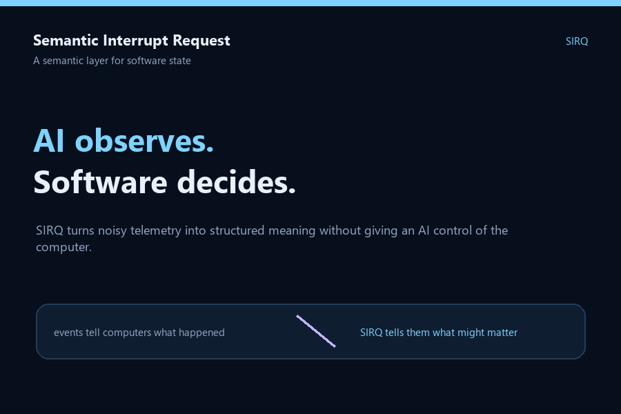

# SIRQ

**Semantic Interrupt Request** — an interrupt controller for meaning.

SIRQ turns messy software state into structured semantic signals while keeping all authority in deterministic, inspectable policy code. The initial implementation is deliberately small and safe:

- a common observation model
- a deterministic mock Jev semantic evaluator
- typed SIRQ events
- policy routing with masking, debounce, and hysteresis
- JSONL recording and replay
- shadow mode that evaluates existing alerts without changing production
- one-bad-night on-call report focused on interruptions avoided
- safe handlers limited to `IGNORE`, `RECORD`, `DASHBOARD`, and `NOTIFY`
- stdin and webhook-friendly adapters

> AI provides perception. Deterministic code retains authority.

## Quick start

```bash
python -m sirq.cli demo
python -m sirq.cli evaluate examples/degraded-service.json
python -m sirq.cli replay examples/replay.jsonl
python -m sirq.cli showcase --output sirq-showcase.html
python -m sirq.cli oncall-demo --output sirq-one-bad-night.html
python -m sirq.cli serve --port 8099
```

The on-call demo runs an **offline simulation** of nine synthetic alert fixtures through **Shadow Mode**, using the deterministic mock evaluator. It does not suppress, notify, restart, or modify anything in production. The detachable HTML identifies the synthetic provenance and compares fixture outcomes with recommendations. Its 77.8% recommendation difference and 88.9% fixture-label agreement are fixture arithmetic, not measured production reduction or independent accuracy. Mock scores are not calibrated confidence; permitted policy outcomes are not actions executed.



`showcase` runs four deliberately contrasting scenarios and creates a self-contained HTML report: routine high CPU during a scheduled job, a transient API failure, a successful-but-suspicious security event, and an agent blocked on human permission. Open the generated `sirq-showcase.html` in a browser to see the semantic decisions visually.

See [docs/demo.md](docs/demo.md) for the developer demo talk track and live HTTP walkthrough.

The daemon accepts `POST /events` with an observation JSON object and exposes `GET /health`. A stdin adapter is also available:

```bash
printf '%s\n' '{"source":"api","type":"health","observations":{"failures_5m":20},"history":{"normal_failures_5m":1}}' | python -m sirq.cli stdin
```

The mock evaluator is intentionally transparent and deterministic so the system can be developed and tested without Jev API costs. Replace it later through the `SemanticEvaluator` protocol; the daemon and policy engine do not depend on a particular model provider.

## Safety boundary

The MVP does not execute shell commands, restart services, modify files, change networking, or grant an evaluator tool access. Policies only select predefined recording/notification outcomes.

### Offline report presentation

`showcase` and `oncall-demo` visibly declare offline simulation, deterministic mock, synthetic fixtures and no production actions. Generic `report` and `shadow-report` accept arbitrary files and therefore declare input provenance unknown, even when passed the same tracked example file. The renderers/writers preserve positional arguments and accept optional keyword-only `provenance` (escaped text) and `synthetic_demo` (explicit demo metric vocabulary). Neither changes recommendation math. At 320px, summaries, proof and timelines stack into one column; long labels wrap instead of being clipped. Reports are static documents without interactive controls.

### Offline report text

Replay and shadow reports render external strings as escaped HTML text, not as
markup or clickable links. This includes report titles, service/source names,
policy reasons, destinations, and displayed observation evidence. Shadow report
timestamps are shortened for display and then escaped. Review notes and reviewer
names are not included in the report; only review status contributes to metrics.
The templates contain static CSS, numeric bar widths, and enum-derived classes;
they do not embed alert JSON or JavaScript. Keep escaping at the output context
when adding fields: HTML text escaping is not a substitute for URL validation or
safe JSON serialization if future reports introduce links or scripts.

`tests/test_report_safety.py` exercises both real renderers and UTF-8 file writers
with synthetic hostile text, checks parsed tags/attributes against ordinary
reports, and checks that displayed content retains its literal meaning. These
stdlib HTML-source tests are not an all-browser security proof. No report styling
or production/shadow behavior is changed by these tests.

## Development

```bash
python -m unittest discover -s tests -v
```

The project uses only the Python standard library at runtime.
